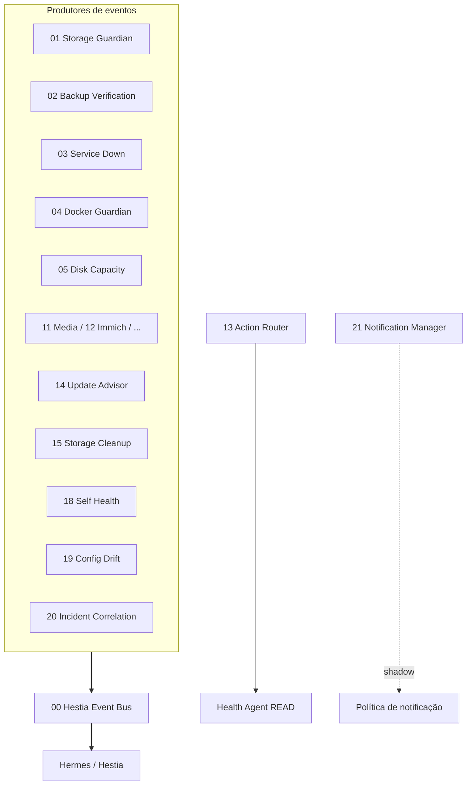

# Dependências

## Nodes n8n observados

- `n8n-nodes-base.code`
- `n8n-nodes-base.filter`
- `n8n-nodes-base.httpRequest`
- `n8n-nodes-base.if`
- `n8n-nodes-base.manualTrigger`
- `n8n-nodes-base.merge`
- `n8n-nodes-base.postgres`
- `n8n-nodes-base.respondToWebhook`
- `n8n-nodes-base.scheduleTrigger`
- `n8n-nodes-base.set`
- `n8n-nodes-base.switch`
- `n8n-nodes-base.webhook`

## Integrações mais recorrentes (heurística de URL/código)

- `postgresql` — 14 workflow(s)
- `rag` — 11 workflow(s)
- `omeab` — 8 workflow(s)
- `docker` — 6 workflow(s)
- `postgres` — 6 workflow(s)
- `hermes` — 4 workflow(s)
- `restic` — 4 workflow(s)
- `telegram` — 4 workflow(s)
- `immich` — 4 workflow(s)
- `audiobook` — 2 workflow(s)
- `media-manager` — 2 workflow(s)
- `obsidian` — 2 workflow(s)
- `config-guardian` — 1 workflow(s)
- `notification` — 1 workflow(s)
- `incident` — 1 workflow(s)
- `update-advisor` — 1 workflow(s)
- `http-port:5678` — 1 workflow(s)

## Credenciais (tipos apenas)

- `postgres` (predominante)

## Grafo de dependências entre workflows

Workflows **não** chamam uns aos outros via Execute Workflow neste inventário; a acoplagem é via **webhook Event Bus** e serviços HTTP.
