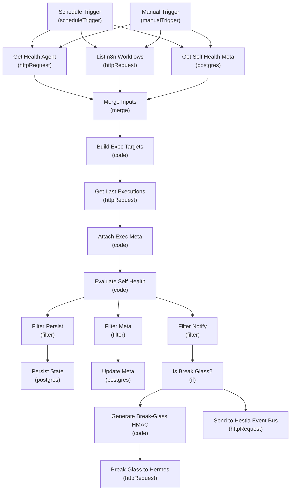
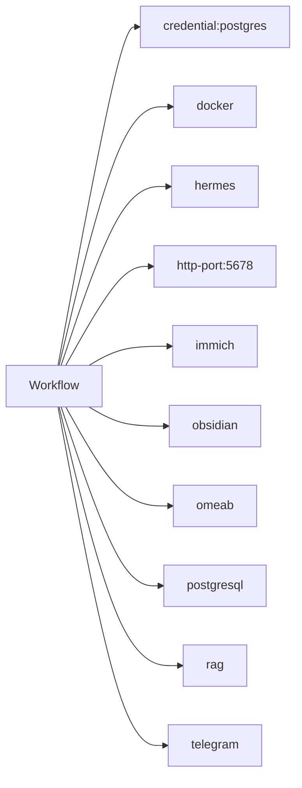
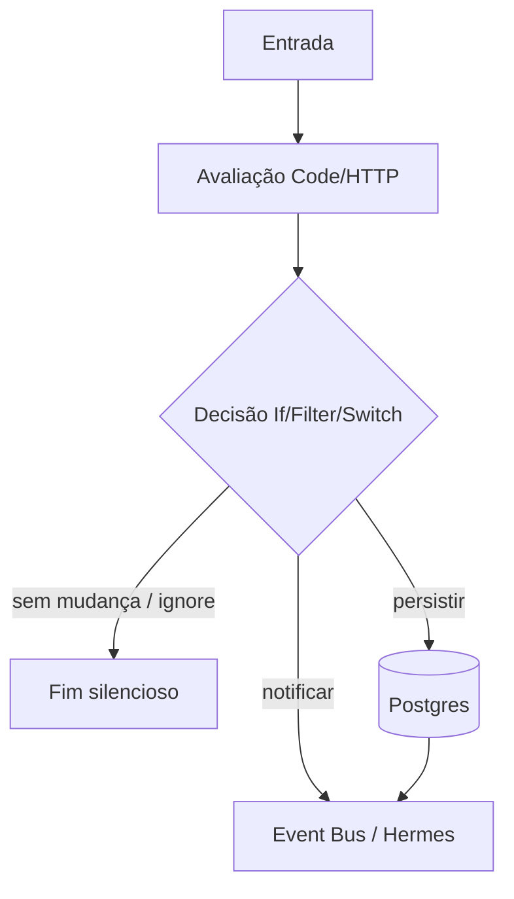
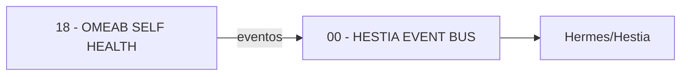

# Diagramas — 18 - OMEAB SELF HEALTH

## 1. Fluxo geral

## 2. Integrações externas

## 3. Tratamento de erros / decisão

> Diagrama 3 é o padrão recorrente OMEAB; o grafo real está no diagrama 1.

## 4. Dependências entre workflows (visão local)

